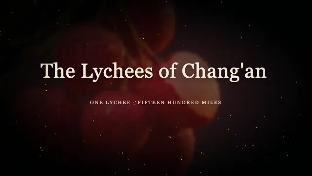

<picture>
  <source media="(prefers-color-scheme: dark)" srcset="../assets/banner-dark.svg">
  <source media="(prefers-color-scheme: light)" srcset="../assets/banner-light.svg">
  
</picture>

# Galanty

**A local video previewer. Open your video, annotate a moment, and let your own Agent make the change.**

[Website](https://galanty.cn/en/) · [Sample gallery](https://galanty.cn/en/samples/) · [Download](https://galanty.cn/en/) · Mac App Store — under review · [Agent guide](https://galanty.cn/en/agents/) · [中文](#中文)

## Change one thing. Back to that second.

| 01 · Open & play | 02 · Annotate | 03 · Hand off | 04 · Resume | 05 · Export |
| --- | --- | --- | --- | --- |
| Open the original project or video file. | Pause at a moment and write what to change. | Give the note to your own Agent. | See the change from the same second. | Take the finished video with you. |

Bring a **Remotion project, HyperFrames / HTML animation, Galanty project, or MP4 / MOV / WebM file**. Your project stays in place. Galanty's own project format is a recommendation, never a prerequisite for opening, playing or annotating.

HTML / HyperFrames projects support preview and annotation; export them with their own rendering tools for now. Export from Galanty for these formats is planned. For a video file, your Agent needs the original project or another editing tool to make the change.

## Works with your Agent

Use **Claude Code, Codex, or any compatible MCP client**. Your Agent writes and edits; Galanty handles playback, annotation and local export.

1. Install and open Galanty on your Mac.
2. Copy the connection configuration from the app's Agent settings into your MCP client.
3. Use the **`@galanty/mcp`** bridge with Node.js 20+ for a stdio client.

```json
{"command":"npx","args":["-y","@galanty/mcp"]}
```

Use the full configuration supplied by the app when it includes connection credentials. Keep those credentials private. [Connection guide →](https://galanty.cn/en/agents/)

## See what you can make

**50 samples across 8 categories.** Browse the Chinese or English gallery for the available language versions, prompts and source downloads.

<p>
  <a href="https://galanty.cn/en/samples/#S107"></a>
  <a href="https://galanty.cn/en/samples/#S108"></a>
  <a href="https://galanty.cn/en/samples/#S125"></a>
  <a href="https://galanty.cn/en/samples/#S110"></a>
</p>

Kids' Stories · Classic Tales · Poetry & Culture · Product Promos · Explainers · Data & Reports · Everyday Notices · About Galanty

[Explore the gallery →](https://galanty.cn/en/samples/)

## Start on your Mac

**Apple silicon Mac, macOS 13 or later.** Download the direct version from the [website](https://galanty.cn/en/).

## Open resources, clear boundaries

| Repository | What belongs here |
| --- | --- |
| [galanty-show/capabilities](https://github.com/galanty-show/capabilities) | Public creative resources, workflow references and standalone tools. |
| `galanty-show/core` | Private application engine. |

**Planned open formats:** `video-review` for timestamped annotations, and `video-recipe` for reproducible making records. Their public specifications are planned, not published standards. Neither format is required to open or annotate a video.

Licenses apply per resource: contracts, tools and CI in `capabilities` use MIT; capability packs, templates, examples and media use CC BY 4.0, subject to each directory's license. The private engine is not covered by those public-resource licenses.

[Resources](https://github.com/galanty-show/capabilities) · [Issues](https://github.com/galanty-show/capabilities/issues) · [MIT](https://github.com/galanty-show/capabilities/blob/main/LICENSE-MIT) · [CC BY 4.0](https://github.com/galanty-show/capabilities/blob/main/LICENSE-CC-BY-4.0)

---

## 中文

### Galanty 文影 · 让视频制作更简单

**本机视频预览器。打开你的视频，标注那一刻，让你自己的 Agent 修改。**

[官网](https://galanty.cn/) · [样片库](https://galanty.cn/samples/) · [下载官网版](https://galanty.cn/) · Mac App Store 审核中 · [Agent 手册](https://galanty.cn/agents/)

### 改一处，回到那一秒

| 01 · 打开播放 | 02 · 标注 | 03 · 交给 Agent | 04 · 回到原秒 | 05 · 导出 |
| --- | --- | --- | --- | --- |
| 原地打开工程或视频文件。 | 暂停，写下想改什么。 | 交给你自己的 Agent。 | 从同一秒检查改动。 | 带走满意的成片。 |

支持 **Remotion 工程、HyperFrames／HTML 动画工程、文影工程，以及 MP4／MOV／WebM 视频文件**。工程留在原处；文影格式只是推荐写法，不是打开、播放或标注的门槛。

HTML／HyperFrames 工程可以预览和标注；目前请用工程自己的渲染工具导出，文影内导出计划支持。只有视频文件时，Agent 需要原工程或其他编辑工具完成修改。

### 用你自己的 Agent

连接 **Claude Code、Codex 或其他兼容的 MCP 客户端**。Agent 写画面、改画面；文影负责播放、标注和本机导出。

1. 在 Mac 上安装并打开文影。
2. 从 App 的 Agent 设置复制完整连接配置到你的 MCP 客户端。
3. stdio 客户端可使用上方的 **`@galanty/mcp`** 配置，需要 Node.js 20 或更新版本。

App 给出连接凭据时，请使用完整配置并自行保管凭据，不要公开。[查看连接手册 →](https://galanty.cn/agents/)

### 看看能做什么

**50 支样片，覆盖 8 类题材。** 中英文样片页按已有语言版本展示，也提供提示词与源码下载入口。

<p>
  <a href="https://galanty.cn/samples/#S107"></a>
  <a href="https://galanty.cn/samples/#S108"></a>
  <a href="https://galanty.cn/samples/#S125"></a>
  <a href="https://galanty.cn/samples/#S040"></a>
</p>

儿童故事 · 经典故事 · 诗词文化 · 产品宣传 · 科普讲解 · 数据报告 · 生活通知 · 文影介绍

[浏览全部样片 →](https://galanty.cn/samples/)

### 在 Mac 上开始

**Apple 芯片 Mac，macOS 13 或更新版本。** 官网版请从[官网](https://galanty.cn/)下载。

### 开放资料与产品边界

| 仓库 | 用途 |
| --- | --- |
| [galanty-show/capabilities](https://github.com/galanty-show/capabilities) | 公开的创作资料、工作流参考与独立工具。 |
| `galanty-show/core` | 私有应用引擎。 |

**规划中的开放格式：** `video-review` 用于带时间的视频批注；`video-recipe` 用于可复现的制作记录。公开规范尚在计划中，不是已发布标准，也不作为打开、标注视频的前提。

许可按资源分别适用：`capabilities` 中的契约、工具与 CI 使用 MIT；能力包、模板、示例与媒体使用 CC BY 4.0，具体文件以所在目录的许可声明为准。私有引擎不适用这些公开资料的许可。

[开放资料](https://github.com/galanty-show/capabilities) · [问题与建议](https://github.com/galanty-show/capabilities/issues) · [MIT](https://github.com/galanty-show/capabilities/blob/main/LICENSE-MIT) · [CC BY 4.0](https://github.com/galanty-show/capabilities/blob/main/LICENSE-CC-BY-4.0)
